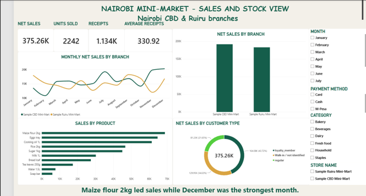
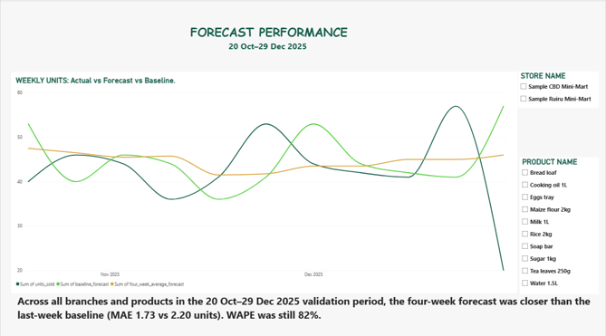
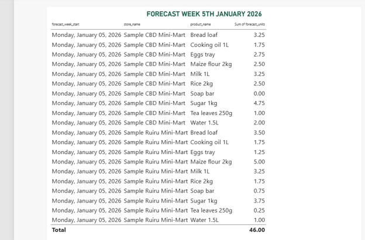

# Nairobi Mini-Market Sales and Customer Insights

An end-to-end analytics project exploring how two mini-market branches could use sales history to plan stock, compare performance, and understand customer purchases. The project covers the full workflow: data preparation, analysis, SQL, forecasting, and a Power BI report.

## Project questions

This project explores four practical questions:

1. Which products and months brought in the most sales?
2. How did the Nairobi CBD and Ruiru sample branches compare?
3. How did sales vary by customer type and payment method?
4. Did a learned weekly forecast improve on simple baselines?

## Dataset overview

The generated dataset covers 1 January to 31 December 2025. It has two fictional branches, 10 products, 100 identified customer IDs, and transactions paid by M-Pesa, cash, or card.

| Measure | Result |
| --- | ---: |
| Raw transaction lines | 1,548 |
| Cleaned transaction product lines | 1,511 |
| Distinct receipts | 1,134 |
| Units sold | 2,242 |
| Net sales | KES 375,259.50 |

The raw transaction file has one row for a product on a receipt. The cleaned file combines repeated matching product lines while preserving the total number of units.

## Data sources and terms

### Generated sales and customer data

The raw files in data/raw/ were created locally by src/generate_data.py with a fixed random seed. They include transactions, stores, products, and fictional customers. Blank customer IDs represent walk-in purchases; no personal customer information is used.

### Public context

The reference file data/reference/knbs_county_population_2019.csv contains county population totals for Nairobi City and Kiambu, transcribed from the [KNBS 2019 Kenya Population and Housing Census, Volume I](https://repository.knbs.or.ke/entities/publication/2521aa6d-1c77-4929-b238-f2d4db65ceab). The KNBS repository lists the publication under **CC BY-NC-SA 4.0**. Population is county-level background context, not a measure of a shop’s customers or catchment area.

## What I built

| Milestone | Work completed |
| --- | --- |
| 1. Problem framing and data acquisition | Defined the business questions, generated the sales data, and documented the KNBS context source. |
| 2. Data cleaning and preparation | Built a repeatable pandas notebook that converts data types, labels walk-in sales, combines repeated receipt items, checks ranges, and saves cleaned data and quality counts. |
| 3. Exploratory data analysis | Compared receipt values, months, weekdays, branches, products, categories, and customer types, then saved five findings. |
| 4. SQL analysis | Prepared PostgreSQL scripts for staging, table building, joins, aggregations, product ranking, customer cohorts, and RFM segments. |
| 5. Statistical analysis | Used Welch two-sample t-tests and 95% confidence intervals to compare promoted and non-promoted receipts, and M-Pesa and cash receipts. |
| 6. Predictive model | Compared a last-week baseline and four-week average baseline with a trained linear regression using past-sales, calendar, branch, and product features on the same time-based validation weeks. |
| 7. Dashboard and storytelling | Built a three-page Power BI report with a sales overview, interactive slicers, forecast validation, and a historical sample forecast table. |

Milestone notes and step-by-step explanations are in the docs/ folder.

## Key findings

- **Product sales:** Maize flour 2kg led the sample with **KES 68,823.00** in net sales from **387 units**.
- **Monthly sales:** December was the strongest month at **KES 37,034.75**; February was the weakest at **KES 26,069.25**.
- **Branch comparison:** Sample CBD Mini-Mart recorded **KES 192,003.50**, about **4.8%** more than Sample Ruiru Mini-Mart at **KES 183,256.00**. Because there is only one sample branch in each county, branch and county effects cannot be separated.
- **Customer type:** Loyalty-member sales were **KES 164,075.25**, about **43.7%** of net sales. Walk-in / not identified sales are not a count of individual people.
- **Promotion test:** Promoted receipts had a higher average gross value by **KES 50.60** in this sample (95% CI: KES 10.75 to KES 90.45; p = 0.0129). This association does not prove that promotions caused the difference.
- **Payment test:** The M-Pesa versus cash difference in average net receipt value was **KES 4.20** (95% CI: KES -35.20 to KES 43.60; p = 0.8345). The sample does not provide clear evidence of a difference.
- **Forecast validation:** On the same 11 later weeks, a trained linear regression had MAE **1.54 units** and WAPE **72.9%**. It beat the four-week average baseline (MAE **1.73**, WAPE **82.0%**) and last-week baseline (MAE **2.20**, WAPE **104.5%**). The remaining error is high, so this is not ready for restocking decisions.

## Power BI dashboard

The Power BI report has a Sales page with KPI cards, monthly sales, product and branch comparisons, customer-type sales, and slicers for month, payment method, category, and branch. The Forecast Performance page compares actual weekly units with two forecasts and includes branch and product filters. The separate sample forecast table shows a projection for the week starting **5 January 2026**. That date is now in the past, so the table is a historical demonstration, not a current restocking recommendation.

The saved Power BI forecast page shows the two original baseline methods. The newer regression comparison is documented in the forecasting notebook and evaluation report; the dashboard screenshot has not yet been updated to show that third method.

### Sales overview



### Forecast performance



### Historical sample forecast



The Power BI file is reports/nairobi_mini_market_dashboard.pbix.

## Run the Python notebooks

### Set up Python

From the repository root, create and activate a virtual environment, then install the listed packages:

```bash
python -m venv .venv
# Windows in PowerShell
source .venv/Scripts/activate
# macOS or Linux instead
# source .venv/bin/activate
python -m pip install pip
python -m pip install -r requirements.txt
```

In Jupyter, select the Python kernel from this `.venv` environment. The notebooks use pandas and NumPy for data work, plus Matplotlib and SciPy for the analysis.

Run the notebooks in this order:

1. notebooks/data_preparation.ipynb - creates data/processed/clean_sales_2025.csv and reports/quality_report.csv.
2. notebooks/eda.ipynb - creates reports/findings.txt.
3. notebooks/statistical_analysis.ipynb - creates reports/results.md.
4. notebooks/demand_forecast.ipynb - compares the two baselines with a trained linear regression and creates reports/evaluation.md, reports/validation_predictions.csv, and reports/next_week_forecast.csv.

The original raw files remain in data/raw/. Running data preparation again rebuilds the cleaned file and its quality report.

## Run the SQL analysis

Use a PostgreSQL connection in DBeaver. Import the cleaned CSV into the project staging table, then run these scripts in order:

1. sql/create_staging.sql
2. Import data/processed/clean_sales_2025.csv into the staging table.
3. sql/build_tables.sql
4. Run sections of sql/analysis_queries.sql

Reference checks are in reports/sql_results.md. Keep database passwords and connection secrets out of the repository.

## Project files

- data/raw/ - generated transactions, stores, products, and customers.
- data/reference/ - KNBS county population context.
- data/processed/ - cleaned sales data.
- notebooks/ - preparation, EDA, statistical analysis, and forecasting notebooks.
- sql/ - PostgreSQL setup and analysis scripts.
- reports/ - analysis outputs, forecast files, Power BI report, and dashboard screenshots.
- [Project presentation deck](presentation/nairobi_mini_market_presentation.pptx) - problem, data, sales findings, statistical tests, forecast comparison, dashboard, and recommendations.
- docs/ - milestone guides and explanations.
- src/ - synthetic data generator.

## Limitations

The sales and customer data is fictional and covers one year. Findings describe this dataset, not actual Nairobi market activity. Promotions were not randomly assigned, so the statistical comparisons are exploratory and not causal. Repeated customer receipts mean observations may not be fully independent. The forecast was tested on only 11 later weeks and still has substantial error. The sample projection for 5 January 2026 is historical, not a current stock recommendation.
